# PythonImproved Dung Beetle Algorithm, FuchMapping+Backward learning+Adaptive step size+Random differential mutation

Some friends have been continuously messaging in the background, requesting to implement the Gyrolassist algorithm.MATLABChange language toPythonLanguage. No need to say more, let's arrange it.!   
This article uses Python code to reproduce an improved ant colony optimization algorithm published in the top journal of Category A1 at the Chinese Academy of Sciences in 2024.
The paper cites as follows:
Li Y, Sun K, Yao Q, et al. A dual-optimization wind speed forecasting model based on deep learning and improved dung beetle optimization algorithm[J]. Energy, 2024, 286: 129604.  
The principle of the improved ant optimization algorithm is as follows:
Improvement strategy
Improvement point 1: Integrating Fuch chaos with reverse learning strategy in the application of population initialization.
Population initialization is randomly generated in DBO, which may lead to an uneven distribution of the population initialization and result in a diversity of the initialized population. By integrating chaotic initialization methods with reverse learning strategies for population initialization, we can combine them to enhance the convergence speed of DBO.
The Fuch chaotic map formula is as follows:
While generating initial solutions using the Fuch chaos map, a reverse learning strategy is introduced to expand the search space for Dung Beetle, thereby enhancing the quality of the initial solutions for the population. The mathematical expression of the reverse learning strategy is as follows:
OPi is the inverse solution corresponding to each initial solution Pi. Pmax and Pmin represent the maximum and minimum values in the initial solution, respectively. K is a random value within the range (0, 1).
Improvement point 2: Integrating the adaptive step size strategy with the convex lens imaging strategy.
The paper introduces a dynamic selection strategy to enhance the algorithm's search performance. This strategy alternates between an adaptive step size strategy and a convex lens imaging inversion strategy to update the target position with a certain probability. 
In the initial iterations, a larger step size can expand the search for food, enhancing the algorithm's global search capability and promoting faster convergence to better solutions. In later iterations, a smaller step size is beneficial for local search. The pattern of step size changes guides the search of the foraging locomotor beetles, indicating a transition from global to local search within the overall environment. The control factor α0 for the adaptive step size is determined by a linearly decreasing factor, as shown below: 
At the same time, a convex lens imaging learning strategy is introduced to perturb the locomotor beetle population to enhance diversity and increase the likelihood of the algorithm escaping local optima. This equation is represented as follows: 
This strategy has been detailed in previous improved algorithms, specifically refer to: Three strategies for improving the sand cat optimization algorithm (MSCSO) 
The choice of updating the target position using which strategy is determined by the selection probability Ps, 
When the random value Ps<0.5, a random step size strategy is used for position updating; otherwise, the convex lens inverse learning strategy is used for position updating, as shown in the following equation: 
Improvement point 3: Random differential mutation strategy  
The position update equation for the locomotor beetle's stealth behavior updates its position based on the current optimal value of the individual, which may lead to a decrease in population diversity and potentially trap the algorithm in a local optimum state, resulting in low convergence accuracy and efficiency. Therefore, this paper introduces a random differential mutation strategy to enhance the diversity of the locomotor beetle population. The formula is as follows: 
where P (t+1) represents the new individual obtained through random differential mutation, r1 and r2 are random values between [0,1], P∗ is the current best individual position, P′(t) is the position of an individual randomly selected from the population.
Utilize the powerful opfunu library of Python, integrating 11 CEC function libraries such as CEC2005/2008/2010/2013.
This article will improve the Dung Beetle algorithm and the original algorithm in multiple aspects.CECContrast the function set and draw the function images, iterative curves..  
Tested in CEC2005:
F1:  
F2:  
Tested in CEC2008:
F1:  
Tested in CEC2010:
Tested in CEC2021:
Tested in CEC2022:
Other function sets will not be displayed one by one. Note: The improved algorithms are not necessarily the best for all functions, as all of them can only ensure good performance on most functions.
The required package versions are as follows:
matplotlib~=3.8.2\nnumpy~=1.26.3\nopfunu~=1.0.1\n  
Partial code display

## Images

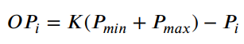
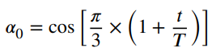
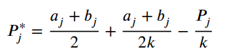
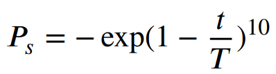

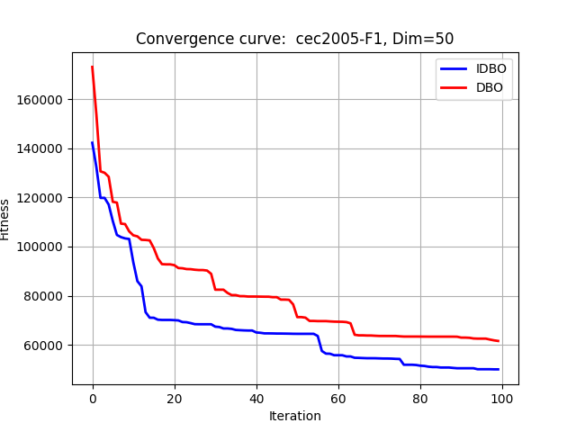
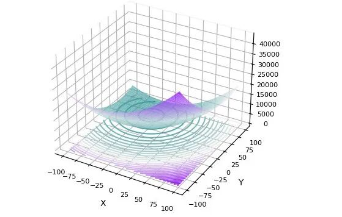
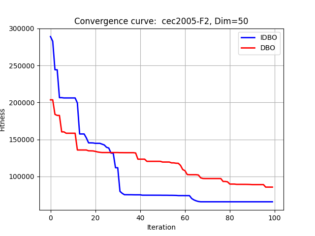
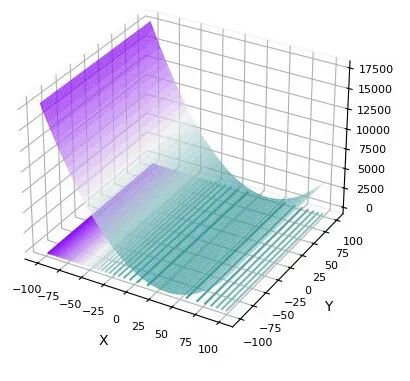
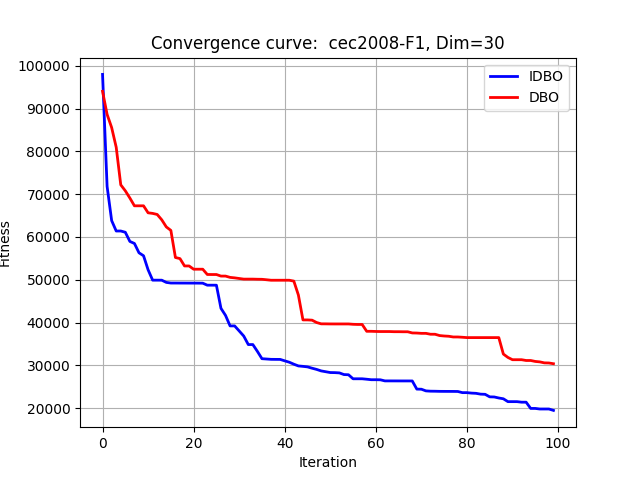
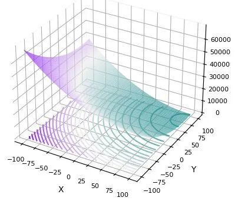
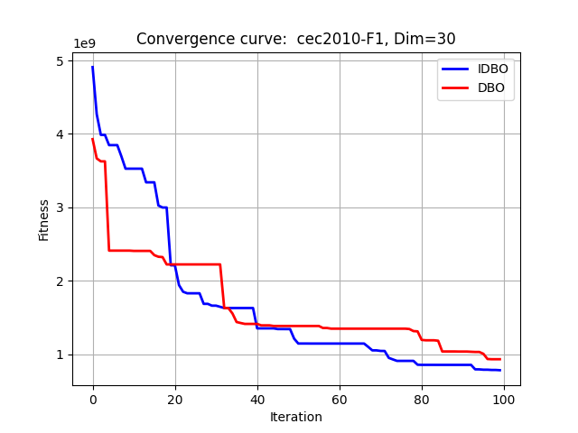
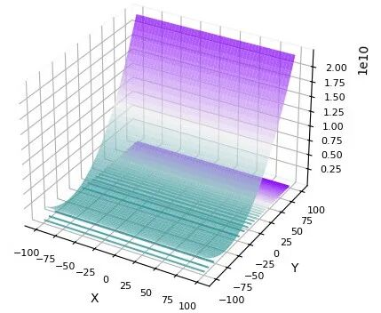
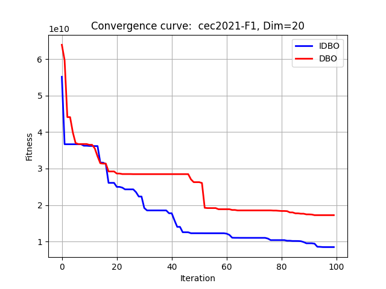
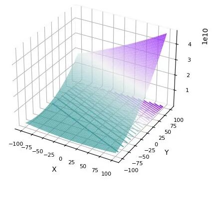
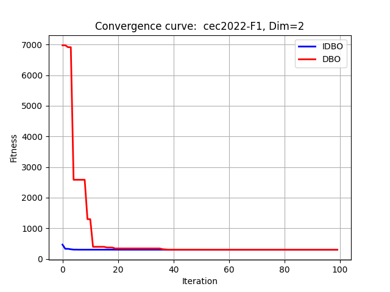
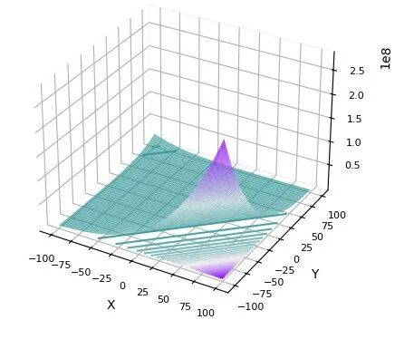

<!-- PAYMENT_BLOCK -->

## Get this dataset

- Payment link (Stripe): [Buy now](https://buy.stripe.com/3cs8yP7sY87d0vu9AB)
- Payment QR code: 

<!-- /PAYMENT_BLOCK -->
